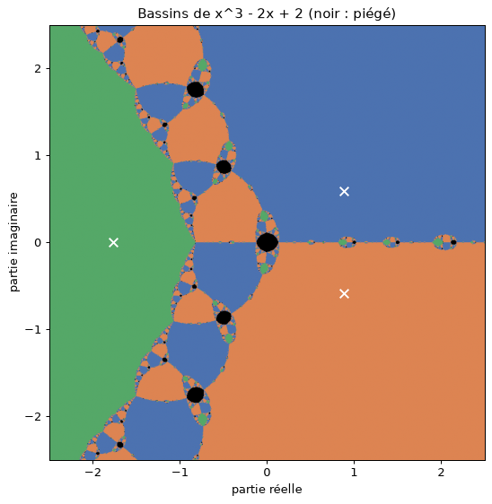

# R1.07 Outils fondamentaux : TP et projet

BUT informatique, semestre 1. Ce dépôt contient mes solutions aux TP du module et mon projet
personnel.

| Dossier | Contenu |
|---|---|
| [`tp/`](tp/) | les carnets des six TP (`tp1.ipynb` à `tp6.ipynb`) : exercices de séance, partie « Entraînement et approfondissement », et quelques essais en plus de l'énoncé |
| [`projet/`](projet/) | le projet, « Quand Newton tourne en rond » |

## Le projet : quand Newton tourne en rond

Au TP3, la méthode de Newton appliquée à x³ − 2x + 2 depuis 0 tourne indéfiniment entre 0
et 1. Le projet part de cet échec et cherche si c'est un accident ou toute une région de points
de départ, quelle chance on a d'y tomber, et ce qui se passe pour x³ − 2x + c quand c varie.

Notions du module utilisées : flottants (critères d'arrêt, limites de précision), polynômes
(Horner, dérivée, division), recherche de racines (Newton, dichotomie), systèmes linéaires
(pivot de Gauss pour les moindres carrés), géométrie du plan et Monte-Carlo (aires et
proportions de points).

### Lancer

Python 3.10 ou plus, avec numpy, matplotlib et Jupyter :

```
pip install numpy matplotlib jupyter
cd projet
jupyter notebook projet.ipynb
```

puis « Run All » (environ quatre minutes). Le carnet est enregistré avec ses résultats : on peut
aussi le lire sans l'exécuter, y compris sur GitHub.

| Fichier | Rôle |
|---|---|
| `polynomes.py` | Horner, dérivée, division par (x − r), Newton, toutes les racines, Newton sécurisé |
| `systemes.py` | pivot de Gauss du TP4 et droite des moindres carrés |
| `bassins.py` | Newton sur une grille de points du plan complexe, tirages en couronne, comptage de boîtes |
| `famille.py` | orbite de 0 pour x³ − 2x + c, diagramme de bifurcation, recherche des s_k par dichotomie |
| `projet.ipynb` | les expériences et leur interprétation |

### Ce qu'on doit observer



- Le piège n'est pas un point : 0,74 % des points de [−2,5 ; 2,5]² finissent sur le cycle
  0, 1, et cette proportion ne bouge plus au delà de 40 itérations (partie 3).
- La zone piégée se répète à l'identique, agrandie de 1,5, jusqu'à l'infini, car
  N(z) ≈ 2z/3 loin de l'origine. Son aire est infinie, et environ un point de départ sur 200
  y tombe, aussi loin qu'on parte (partie 5).
- La frontière entre bassins a une dimension d'environ 1,35 (comptage de boîtes, partie 6).
- Il y a un piège exactement quand l'orbite de 0, seul point hors des racines où N′ s'annule,
  ne trouve pas de racine. Confronté aux grilles, ce test a trois failles, analysées dans la
  partie 7.
- Autour de c = 2 la période du cycle double en cascade, et le rapport entre doublements
  successifs tend vers la constante de Feigenbaum : 4,66920, limité à 6 chiffres par les
  flottants (partie 8).
- Dans le plan des c complexes apparaît une copie de l'ensemble de Mandelbrot (partie 9).
- Un Newton protégé par dichotomie ne se fait jamais piéger, là où Newton seul échoue sur un
  départ réel sur cinq à un sur quatre près de c = 2 (partie 10).

Les limites (théorème utilisé sans démonstration, nombre d'itérations, loi de tirage,
précision) sont discutées dans la partie 11 du carnet.

## Utilisation d'un assistant IA

Un assistant IA a été utilisé pour le TP6, la correction de l'exercice 6.1 du TP2 et
le projet : écriture d'une partie du code et des commentaires, et mise en forme de ce README.
Tous les résultats chiffrés ont été obtenus en exécutant le code, et chaque fonction est
vérifiée dans les carnets par une propriété ou une référence : relations entre coefficients et
racines, `np.roots` et `np.polyfit`, cercle et carré pour le comptage de boîtes, deux formules
équivalentes du pas de Newton pour la précision des s_k.
